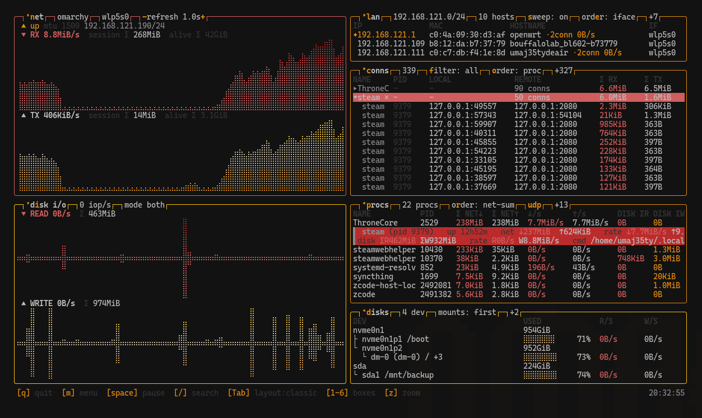

# ltop/localist top

[English](README.md) | [简体中文](docs/README.zh-CN.md)

[](https://crates.io/crates/ltop)
[](https://docs.rs/ltop)
[](https://github.com/uMaj35ty/ltop/actions/workflows/ci.yml)

**One screen to find the process eating your bandwidth or disk** —
per-process network and disk I/O, per-connection traffic, and LAN
neighbours, in a btop-style terminal. For software and game developers,
sysadmins and enthusiasts. The main program runs without root; an optional
eBPF helper adds per-process and per-connection byte accounting.

📖 **Documentation, screenshots & gallery: [umaj35ty.github.io/ltop](https://umaj35ty.github.io/ltop/)**
— this README is the elevator pitch plus everything needed to install and
start; the deep details live on the docs site.



## Quick install

**Homebrew** (macOS & Linux; prebuilt binaries):

```bash
brew install uMaj35ty/ltop/ltop
```

**crates.io** (compiles from source; needs a Rust toolchain):

```bash
cargo install ltop
```

**GitHub Releases** — prebuilt tarballs for `x86_64/aarch64` Linux and macOS
(glibc 2.35+ on Linux). Binaries are unsigned; on macOS remove the quarantine
attribute after downloading: `xattr -c ltop-*-darwin.tar.gz`.
AUR: `ltop-bin` — package ready, publication pending the AUR reopening
registration. The out-of-the-box `loli` alias was retired in 0.2.4 — make your
own with a symlink if you miss it.

## First run

```bash
ltop
```

No root, no configuration. The keys that matter on the first screen:

| Key | Does |
|---|---|
| `Tab` | cycle layouts: classic → wide → tall |
| `/` | search processes/connections by name |
| `enter` | detail panel on the selected row (full command line, per-connection breakdown, track / kill / relaunch) |
| `p` / `c` / `l` | single-focus procs / conns / lan |
| `enter` on a LAN row | pin the neighbour and filter CONNS to that peer |
| `1`–`6` / `z` / `space` / `m` | toggle boxes / zoom / pause / menu |

Full key table and the six-box tour: [the docs](https://umaj35ty.github.io/ltop/docs/tui.html)
(always available in-app via `m` → help).

**Optional (Linux)** — exact per-process/per-connection accounting incl. UDP
via the privileged eBPF helper:

```bash
sudo cp ltop-bpf /usr/local/bin/            # from the same release as the TUI
sudo cp ltop-bpf.service /etc/systemd/system/
sudo systemctl enable --now ltop-bpf
```

Re-deploy the helper together with the TUI when upgrading — a stale
`ltop-bpf` silently zeroes per-process accounting.

## For AI agents

`ltop --json` emits a structured snapshot (schema v1: network rates,
per-process and per-connection accounting, disk I/O, LAN neighbours);
`ltop --schema` is the versioned field reference. The companion agent skill
([docs/skills/ltop-observe/SKILL.md](docs/skills/ltop-observe/SKILL.md))
teaches agents when and how to use it, with diagnostic recipes.

For time-window monitoring, **`ltop watch`** records schema-v1 JSONL headlessly
and **`ltop report`** aggregates it — exact window sums and peaks instead of
sampled guesses:

```bash
ltop watch --duration 10m --proc chrome   # record (crash-safe JSONL, no root);
                                         # prints the output path
ltop report <that path> --json            # ~2 KB summary (single file)
```

Measured on a live desktop: polling `--json` over 10 minutes costs ~40k tokens;
`report --json` is ~1k — **~97 % fewer tokens**. One-shot questions: a filtered
`--json` snapshot is ~1.7k tokens vs ~22k for the traditional shell-command
combination. Details: [AI agents on the docs](https://umaj35ty.github.io/ltop/docs/ai.html).

## Features

- **Six boxes, one job each** — NET (per-NIC braille charts, link state,
  cumulative traffic) · LAN (auto-discovered neighbours with per-peer
  connection count, rate and bytes) · DISK I/O + DISKS (rate charts,
  device tree, capacity bars) · CONNS (every socket, true per-connection
  B/s and totals, process grouping, tombstones for closed connections) ·
  PROCS (session-total network TCP+UDP and disk per process; exited
  processes stay, grayed out, relaunchable)
- **eBPF accounting, optional (Linux)** — kprobes on send/recv (v4+v6)
  accumulate bytes per pid and per socket inode; the unprivileged UI diffs a
  1-second snapshot from `/run/ltop/udp.json`. LRU maps, single-instance
  lock, automatic detach — no root for the TUI, no nightly toolchain to
  build. Without the helper everything else keeps working
- **Headless watch + report** — crash-safe JSONL capture (per-line appends
  survive a process crash; `--interval`, `--duration`, `--stop` sentinel,
  `--proc` focus) and window-differenced summaries; the TUI monitoring log (`L` / `--log`) shares the schema, and
  `--replay`/`--csv` replay watch, monlog and legacy session logs
- **Three layouts, focus & zoom** — `Tab` cycles classic/wide/tall; `p`/`c`/`l`
  single-focus; selection follows rows across re-sorts; `z` zooms; mouse
  scroll/click works
- **72 embedded btop themes** — any btop theme file loads as-is
  (`--theme <file>`); on Omarchy the palette follows the desktop theme, and
  `--follow-theme` re-colors a running ltop live (off by default); UI in
  English or Chinese (`lang = zh` in `~/.config/ltop/config.conf`)
- **Linux & macOS, x86_64 + aarch64** — macOS reads Apple-native sources
  (nettop, libproc, IOKit, route socket); verified per release in QEMU/KVM on
  five distributions (incl. SELinux enforcing and a no-BTF kernel) and on
  Apple Silicon hardware — the [compatibility page](https://umaj35ty.github.io/ltop/docs/compat.html)
  has the matrix and platform caveats

## Data scopes (a mismatch is not a bug)

- **PROCS** = application payload bytes; the **NET box** = NIC bytes
  (headers, retransmits, kernel traffic included) — a 10–40 % gap is expected
- **CONNS** TCP Σ = the kernel's per-socket counters (whole connection
  history, including before ltop started); UDP Σ = session-accumulated
- **NET Σ**: session Σ (since ltop started, resettable) vs alive Σ (≈ since
  the interface came up)
- Traffic through a proxy is attributed to the proxy process

## Documentation

| Page | Contents |
|---|---|
| [Quick start](https://umaj35ty.github.io/ltop/docs/quickstart.html) | install + the keys that matter |
| [The TUI](https://umaj35ty.github.io/ltop/docs/tui.html) | six boxes, layouts, full key bindings |
| [Themes](https://umaj35ty.github.io/ltop/docs/themes.html) | theme files, Omarchy following, custom colours |
| [LAN discovery](https://umaj35ty.github.io/ltop/docs/lan.html) | passive ARP + UDP knock, pin & filter |
| [eBPF accounting](https://umaj35ty.github.io/ltop/docs/ebpf.html) | helper architecture, guard rails, data semantics |
| [The data plane](https://umaj35ty.github.io/ltop/docs/data.html) | `--json`/`--schema`, monitoring log, watch/report, config keys |
| [AI agents](https://umaj35ty.github.io/ltop/docs/ai.html) | snapshot + watch/report workflow, token numbers, agent skill |
| [Security](https://umaj35ty.github.io/ltop/docs/security.html) | privileges, data on disk, LAN behavior, disclosure |
| [Contributing](https://umaj35ty.github.io/ltop/docs/contributing.html) | setup, conventions, PR flow |
| [Compatibility](https://umaj35ty.github.io/ltop/docs/compat.html) | tested matrix, macOS notes, limitations |
| [Comparison](https://umaj35ty.github.io/ltop/docs/comparison.html) | vs btop / nethogs / iftop / shell pipelines |
| [FAQ](https://umaj35ty.github.io/ltop/docs/faq.html) | common misreads and traps |

## Building from source

```bash
cargo build --release     # target/release/{ltop, ltop-bpf}   (ltop-bpf: Linux)
cargo test                # unit + rendered-frame + live integration tests
cargo clippy              # zero warnings
```

Rust stable; on Linux a clang with the `bpf` target builds the eBPF object —
without clang the build still succeeds and only UDP accounting degrades
silently. Diagnostics live in `scripts/` (`udp-smoke.sh`, `snap-diff.py`,
`soak.sh`); the eBPF program is `bpf/net_bpf.c`; collectors under
`src/collect/`; the systemd unit in `deploy/`.

## Acknowledgements

Special thanks to **Aristocratos**
([btop](https://github.com/aristocratos/btop)) and the authors of btop's
official theme collection — ltop's theme format is btop's and 41 of the
built-in themes are converted from that collection — and to **DHH**
([Omarchy](https://github.com/dhh/omarchy)) and the creators of Omarchy's
bundled themes, from which the other 31 come. Every one of those themes
remains the work of its author; see
[Themes → Acknowledgements](https://umaj35ty.github.io/ltop/docs/themes.html#acknowledgements).

Themes are ported from btop (Apache-2.0); all other code and docs are
released under the MIT license (see [LICENSE](LICENSE)).
