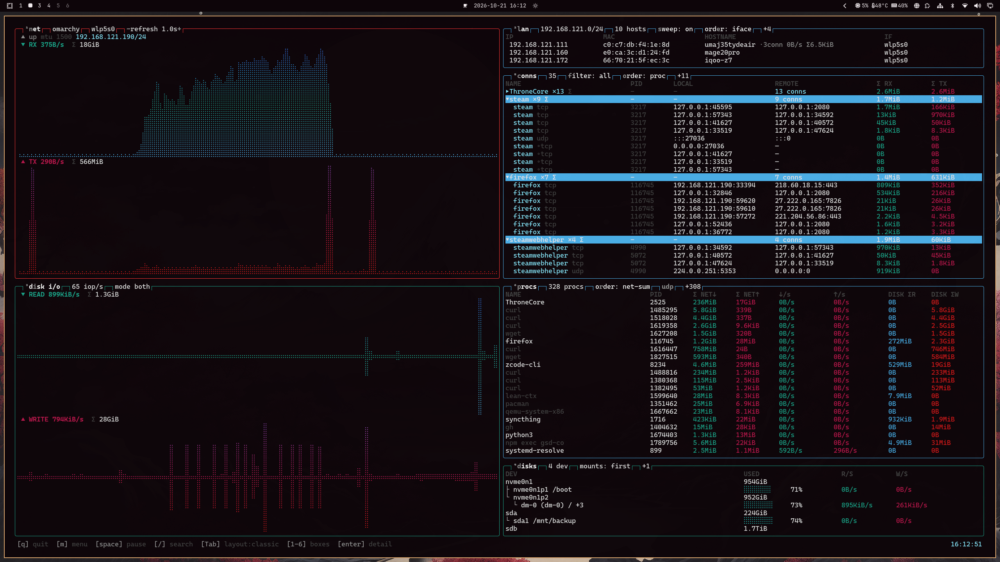
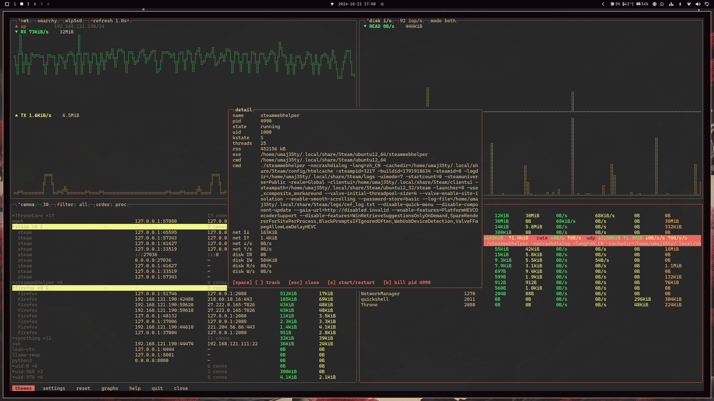
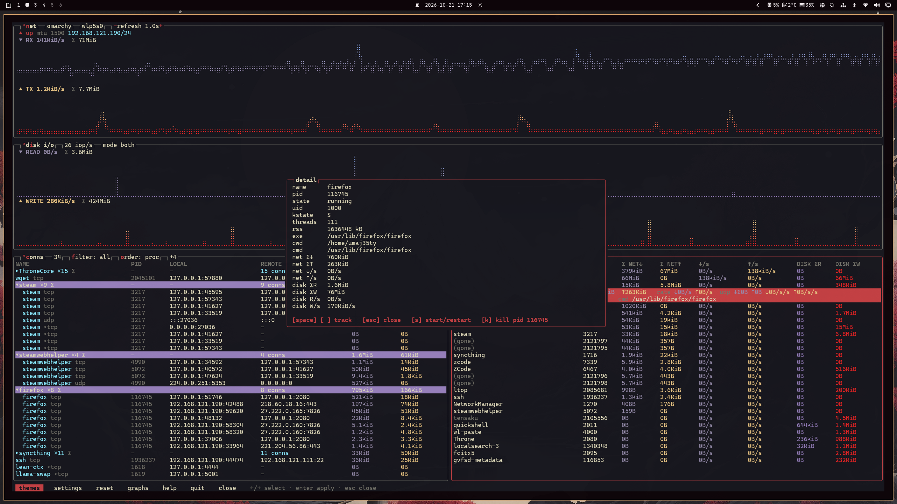

# ltop/localist top

[English](README.md) | [简体中文](docs/README.zh-CN.md)

[](https://crates.io/crates/ltop)
[](https://docs.rs/ltop)
[](https://github.com/uMaj35ty/ltop/actions/workflows/ci.yml)

A terminal monitor for a single machine: where network traffic goes (who talks
to whom), what the processes are doing (who eats bandwidth and disk), and what
the LAN looks like — the main program runs without root, and an optional eBPF
helper adds per-process and per-connection byte accounting.

## Quick install

**Homebrew** (macOS & Linux; prebuilt binaries):

```bash
brew install uMaj35ty/ltop/ltop
```

**crates.io** (compiles from source; needs a Rust toolchain):

```bash
cargo install ltop
```

**GitHub Releases** — prebuilt tarballs for `x86_64/aarch64` Linux and
macOS. Binaries are unsigned: on macOS remove the quarantine attribute
after downloading:

```bash
xattr -c ltop-*-darwin.tar.gz
```

AUR: `ltop-bin` — coming as soon as the AUR reopens registration (package is ready).

## For AI agents

`ltop --json` emits a structured snapshot (network rates, per-process and
per-connection accounting, disk I/O, LAN neighbours); `ltop --schema` is the
versioned field reference. The companion agent skill
([docs/skills/ltop-observe/SKILL.md](docs/skills/ltop-observe/SKILL.md))
teaches agents when and how to use it, with diagnostic recipes.

## Themes

ltop reads btop-compatible theme files — see
[docs/custom-theme.md](docs/custom-theme.md) to fix unreadable colours or
build a full custom theme.

## Screenshots

Classic layout on Omarchy, with the desktop theme followed:



Wide layout with the detail panel (captured command line, per-connection
breakdown, track / kill / relaunch) and the theme menu:



Tall layout — grouped connections with totals and a tracked row highlighted:



Live Omarchy theme following (`--follow-theme`) — the palette re-colors while
ltop runs as the desktop theme switches:


## Features

- **Six boxes, one job each**
  - **NET** — per-NIC real-time throughput (braille area charts), link
    state/speed/duplex/MTU/IP, cumulative traffic since startup
  - **LAN** — automatic same-subnet device discovery: IP / MAC / hostname /
    interface, gateways marked, background scanning; each neighbour shows the
    live connection count, rate and accumulated bytes to it (linked with CONNS)
  - **DISK I/O / DISKS** — read/write rate charts (deduplicated per device) plus
    a physical device tree (`nvme0n1 → dm-0(root)`), capacity bars and live rates
  - **CONNS** — every connection on the system: TCP shows true per-connection
    B/s and totals; UDP connections are eBPF-metered and get the same columns;
    protocol tags, process grouping, 5-second tombstone rows for closed
    connections, four-state filter (all / lan / tcp / udp)
  - **PROCS** — per-process **total** network (TCP+UDP — short-lived connections
    are never missed) and **total** disk I/O for the session; exited processes
    stay grayed out with their captured command line and can be relaunched with
    one key; search, pinned tracking, four sort modes
- **eBPF accounting (TCP+UDP, optional)** — netlink offers no per-socket byte
  counters for UDP, and per-socket TCP sampling loses connections that live for
  less than one sampling tick; a privileged helper `ltop-bpf` attaches kprobes
  to the send/recv syscalls (v4+v6), accumulates bytes per pid and per socket
  inode, and writes a snapshot to `/run/ltop/udp.json` every second. The
  unprivileged UI diffs the snapshots and merges them into its ledgers. No
  nightly toolchain needed — the eBPF object is built with the system clang at
  compile time. Without the helper the feature is silently absent; everything
  else keeps working
- **Monitoring log & replay** — `L` records per-process ledgers to JSONL
  (60 s granularity by default, retention configurable); `--replay` rebuilds
  session deltas into a report, `--csv` exports it
- **Three layouts** — `Tab` cycles classic (charts left, tables right with the
  CONNS bottom edge aligned to the chart split) / wide / tall; boxes toggled
  with `1`–`6` collapse automatically
- **Themes & language** — 41 embedded btop themes switchable at runtime, or
  follow the Omarchy desktop theme (picked up at startup; add `--follow-theme`
  to also re-color a running ltop when the desktop theme changes — off by
  default); UI in English or Chinese
- **Focus & tracking** — `p`/`c`/`l` single-focus procs/conns/lan, arrow-key selection
  that *follows* the process/connection/neighbour across re-sorts, detail panel with
  tracking pin, kill and relaunch; `enter` on a lan row pins the neighbour and
  filters CONNS to that peer

## Requirements & Building from source

Rust stable, and Linux or macOS on **x86_64 / aarch64**. The eBPF
accounting is Linux-only: its probes carry per-arch pt_regs register
mappings for both architectures, need a clang with the `bpf` target
(Arch's `clang` works) and root to deploy the helper.

### Tested environments

Release tarballs verified per distribution in QEMU/KVM (open-box binaries,
eBPF probe attach incl. kprobe, systemd unit, silent degrade without the
helper). ltop is developed daily on Omarchy (Arch), which doubles as the
reference desktop environment.

| Environment | Kernel | eBPF accounting | Notes |
|---|---|---|---|
| Arch Linux (rolling) | 7.2.7 | ✓ full | also the dev machine (Omarchy desktop) |
| Ubuntu 24.04 LTS | 6.8 | ✓ full | glibc 2.39 |
| Ubuntu 22.04 LTS | 5.15 | ✓ full | works **without BTF**; glibc 2.35 is the binary baseline |
| Ubuntu 24.04 LTS (aarch64) | 6.8 | ✓ full | QEMU aarch64 emulation; Raspberry-Pi-class hardware expected to match |
| Debian 13 | 6.12 | ✓ full | glibc 2.41 |
| Fedora 44 (Workstation live) | 6.19 | ✓ full | SELinux enforcing: zero denials |
| macOS 27 (Apple Silicon, MacBook Air) | darwin 27 | n/a (`nettop` path) | verified on hardware; see the macOS notes |

Older kernels trim kprobes/BTF in specialty flavours (e.g. Ubuntu's `-kvm`
cloud kernel): use the `generic` kernel there — not an ltop limitation.

### macOS notes

macOS has no eBPF; the boxes read Apple-native sources instead — PROCS and
CONNS poll `nettop` (per-process rows and per-socket flows, TCP and UDP in
one spawn), CONNS attribution scans the caller's own sockets via libproc
(other users' connections show as `n/a`), DISK reads IOKit IOMedia
statistics plus per-process rusage, LAN parses `arp -an` and the default
route. `ltop-bpf` does not exist on macOS. Counters are cumulative per
live socket: a transfer that completes within one sampling tick is not
counted (a documented difference from the Linux eBPF path). Bare-terminal
framebuffer fonts may miss braille glyphs; rendering over SSH or in a
proper terminal emulator shows them all.

macOS hides parts of the local network from binaries that are not signed
by Apple — independent of the Local Network privacy toggle: the neighbour
table enumerates as empty, single-entry route queries answer with the MAC
sanitized to the interface's synthetic address, and `getifaddrs` byte
counters read frozen (all cross-checked in the same second against the
real values seen by Apple-signed tools). ltop routes around this: the NET
box counts via `netstat -ib`, and the LAN box rebuilds its neighbour list
by probing the kernel cache entry-by-entry over the route socket — IPs,
mDNS hostnames and traffic links are real; MAC addresses show as "—".

```bash
cargo install ltop                   # from crates.io — binaries only, no config
# or build from source:
cargo build --release
./target/release/ltop                # run — zero config
sudo cp target/release/ltop-bpf /usr/local/bin/
sudo cp deploy/ltop-bpf.service /etc/systemd/system/
sudo systemctl enable --now ltop-bpf # enable per-process/per-connection accounting
```

**Upgrading**: re-deploy the helper together with the TUI — a stale
`/usr/local/bin/ltop-bpf` keeps writing its snapshot to the old path and
per-process accounting silently zeroes:

```bash
sudo cp target/release/ltop-bpf /usr/local/bin/
sudo systemctl restart ltop-bpf
```

Binaries: `ltop` and `ltop-bpf` (privileged collector). Release tarballs and the
AUR package ship a `loli` symlink as an out-of-the-box alias (`-h` follows the
invoked name); `cargo install` users can add it with `ln -s ltop loli`.

```bash
ltop --theme <btop.theme>   # theme file
ltop --dump                 # print one sampling round headlessly (debug)
ltop --log                  # start with the monitoring log recording
ltop --replay [--csv OUT]   # replay/analyse the latest session log
ltop-bpf --once             # collector: sample once, print, exit (smoke test)
```

`~/.config/ltop/config.conf` is plain `key = value`, written by the
in-app settings panel and safe to hand-edit (applies on restart): refresh
`tick_ms`, log interval/retention, sweep interval, box toggles, sort defaults,
tombstone TTL `tombstone_ttl_ms`, `theme`, `lang` and more.

### Smoke test & diagnostics

```bash
sudo bash scripts/udp-smoke.sh    # generate accountable UDP traffic, verify the snapshot
python3 scripts/snap-diff.py      # sample the snapshot, print per-pid raw deltas
```

## Key bindings

| Key | Action |
|---|---|
| `q` / `Ctrl-C` | quit |
| `space` | pause/resume sampling (frame freezes; bytes are back-filled on resume) |
| `/` | search: substring-filter processes/connections by name (`Tab` switches the target box, `enter` applies, `esc` clears) |
| `m` | btop-style menu (themes / settings / reset / graphs / help / quit / close) |
| `Esc` | clear focus & selection on the main screen; closes panels |
| `1`–`6` | toggle boxes: 1 net, 2 lan, 3 disk i/o, 4 disks, 5 conns, 6 procs |
| `Tab` | layout classic → wide → tall |
| `p` / `c` / `l` | single-focus procs / conns / lan (lighting one extinguishes the others) |
| `r` | procs sort: name → net-sum → net-rate → disk-sum → disk-rate |
| `f` / `o` | conns filter all → lan → tcp → udp / sort **proc** (same-name processes grouped by total traffic; group head shows `▸/▾name ×N`, group Σ, row tinted by expand state) → sum → name → rate |
| `enter` / `←` `→` on a group head | collapse / expand that process group (search hits auto-expand; clicking a group head toggles too; default state configurable in settings) |
| `d` | expand/collapse the disk mount tree |
| `e` | lan sort: ip → hostname → mac → iface |
| `n` / `i` | switch NIC / disk i/o chart mode |
| `↑↓` / `PgUp` `PgDn` / wheel | move selection / scroll lists; the wheel scrolls the list under the cursor, clicking a row selects it (btop-style, no visible scrollbar) |
| `enter` on a lan row | pin the neighbour to the top (red highlight) **and filter CONNS to that peer**; `enter` again unpins and clears; `esc`/`f` also clear |
| `enter` on a conns/procs row | detail panel: processes show exited state, captured command line, UDP breakdown and uptime; connections show protocol, owner, lifetime, totals and rates; `space`/`t` pin (tracked rows stay on top), `k` kill, `s` relaunch |
| `k` | SIGTERM the selected process (needs "global kill" enabled in settings) |
| `L` | start/stop the monitoring log |
| `s` | LAN sweep on/off |
| `+` / `-` | refresh interval ±250 ms |

Closed connections remain as grayed **tombstone rows** for 5 s (values frozen at
their last state; the tombstone TTL is configurable in settings).

## Data scopes (a mismatch is not a bug)

- **PROCS** = application payload bytes (eBPF, session-accumulated); the **NET
  box** = NIC bytes (includes IP/TCP headers, retransmits, kernel traffic) —
  a 10–40 % gap between the two is expected
- **CONNS**: TCP Σ counts since the connection was established (kernel
  semantics, including before ltop started); UDP Σ is session-accumulated
- Traffic through a proxy is attributed to the **proxy process**

## How it works

- **eBPF pipeline**: kprobes on the send/recv syscalls accumulate bytes per pid
  and per socket inode (the inode is resolved in-kernel via a CO-RE walk of
  sk→socket→file→inode), snapshot atomically every second, then diffed and
  merged by the unprivileged UI. Guard rails: a 16 MiB value gate on register
  reads, a flock single-instance lock, and snapshot instance IDs so the UI
  re-baselines instead of diffing across collector restarts. Detaching is
  automatic on exit — a crashed collector never leaves probes behind
- **LAN discovery**: passive `/proc/net/arp` reads plus a discard-port UDP knock
  every 60 s (the kernel does the ARP, no application traffic); hostnames via a
  three-step best-effort chain: mDNS reverse lookup → NetBIOS node status →
  reverse DNS
- **Data sources**: netlink `inet_diag` (connection table, TCP counters),
  `/proc/net/dev`, `/proc/diskstats` + `statvfs`, `/proc/net/arp` — see the
  header comments in `src/collect/` for details

## Limitations

- Connections of other users can only be attributed to the uid level
  (`/proc/<pid>/fd` is unreadable for them)
- WiFi NICs expose no link `speed` from the kernel; the field stays empty
- CONNS TCP totals include the connection's whole history (kernel semantics),
  which differs from PROCS session totals by design
- After an `ltop-bpf` restart the eBPF counters start from zero (the UI
  re-baselines automatically via snapshot instance IDs)
- On macOS the counters cover live sockets only: traffic of a connection
  that closes within one sampling tick is missed (nettop semantics), and
  ltop-bpf is not part of the macOS build

## Development

```bash
cargo test        # 108 tests: unit, rendered-frame (TestBackend), live netlink+snapshot integration
cargo clippy      # zero warnings
```

Diagnostics live in `scripts/` (`udp-smoke.sh`, `snap-diff.py`); the eBPF
program is `bpf/net_bpf.c`; collectors are under `src/collect/`; the privileged
daemon is `src/bin/ltop_bpf.rs`; the systemd unit is in `deploy/`.

Themes are ported from [btop](https://github.com/aristocratos/btop)
(Apache-2.0); all other code and docs are released under the MIT license
(see [LICENSE](LICENSE)).
