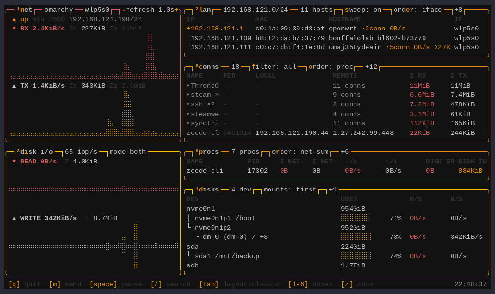

# 简介

**ltop**（localist top）是一款只盯一台机器的终端监控器。btop、nethogs、iftop
各答对一部分的问题，它三个一起答:

1. **流量去哪了？** —— 谁在和谁通信、走哪块网卡、速率多少，每连接、每进程
   的字节计费（TCP **和** UDP）都有。
2. **进程在干什么？** —— 谁正在吃带宽和磁盘，整场会话累计吃了多少；进程退出
   了也留账。
3. **局域网上有谁？** —— 哪些设备在线、哪个是网关、到每台设备的流量是多少。

## 工作方式

六个盒子各司一职（NET、LAN、DISK I/O、DISKS、CONNS、PROCS），[ratatui]
渲染，btop 风格的盲文图表。主程序**免特权**运行——不要 root、不要 setuid、
没有守护进程。Linux 上有一个*可选*的特权助手（`ltop-bpf`，小型 eBPF 采集器），
补齐每进程/每连接的 TCP 与 UDP 字节计费；没有它其余功能照常。macOS 上同样
六个盒子读 Apple 原生源（nettop、libproc、IOKit、路由 socket）。所有显示面
背后是同一份数据面: `ltop --json` 输出 schema-v1 快照，`ltop watch` 无头录制，
`ltop report` 聚合时间窗——这正是 ltop 能被 **AI 代理**直接使用的原因（比轮询
省 ~97% token，见 [AI 代理](ai.md)）。

[ratatui]: https://ratatui.rs

## 亮点

- **真实的逐连接计费** —— 每条 TCP 连接都有实时 B/s 和累计总量；UDP 连接由
  eBPF 计量，列与 TCP 相同。关闭的连接留 5 秒墓碑行，突发流量不会看丢。
- **跨重启存活的进程总量** —— PROCS 按进程累计整场会话的网络（TCP+UDP）与
  磁盘 I/O；退出的进程灰显保留，带捕获的完整命令行，一键重启。
- **带流量的 LAN 邻居** —— 被动 ARP 加周期 UDP knock 扫描发现同子网设备
  （IP、MAC、mDNS 主机名、接口）；每个邻居带实时连接数、速率和累计字节，
  `enter` 置顶它并让 CONNS 只看这个对端。
- **无头 watch + report** —— 时间窗录成崩溃安全的 JSONL，再聚合出精确的窗口
  总和、峰值速率和活跃时长（人读表格或 ~2 KB JSON）。
- **72 套内嵌 btop 主题** —— 任何 btop 主题直接可用；Omarchy 下可跟随桌面
  主题，`--follow-theme` 让运行中的 ltop 实时变色（默认关）。界面英文或中文
  （`lang = zh`）。
- **三布局一键切换** —— `Tab` 循环 classic / wide / tall；`1`–`6` 开关盒子；
  `z` 把焦点盒子放大全屏。

## 下一步

- [快速上手](quickstart.md) —— 安装加最要紧的键，两分钟。
- [安装](installation.md) —— 全渠道、平台要求、eBPF 助手部署。
- [TUI 界面](tui.md) —— 全部界面: 盒子、布局、键位。
- [AI 代理](ai.md) —— JSON 快照、watch + report、打包好的 agent skill。

## 现状

ltop 以 MIT 协议发布，日常开发环境是 Omarchy（Arch Linux），每个 release 在
QEMU/KVM 的五个发行版加 macOS 实机上验证——见[兼容性](compat.md)。分发渠道:
[Homebrew]、[crates.io]、[GitHub Releases] tarball（x86_64 + aarch64）；AUR
`ltop-bin` 打包就绪，等 AUR 开放注册。

[Homebrew]: https://github.com/uMaj35ty/ltop#readme
[crates.io]: https://crates.io/crates/ltop
[GitHub Releases]: https://github.com/uMaj35ty/ltop/releases
