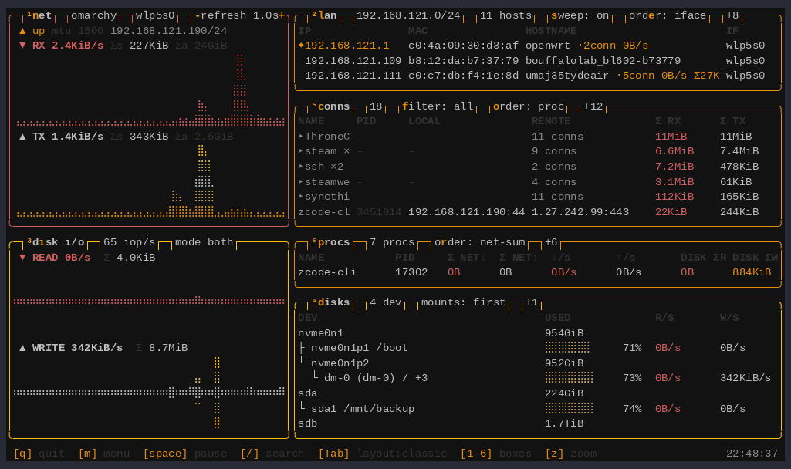
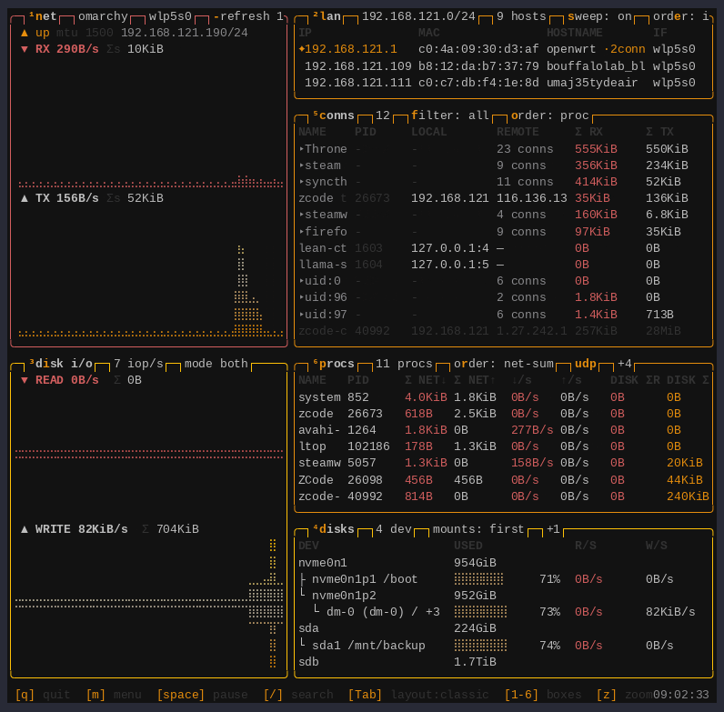
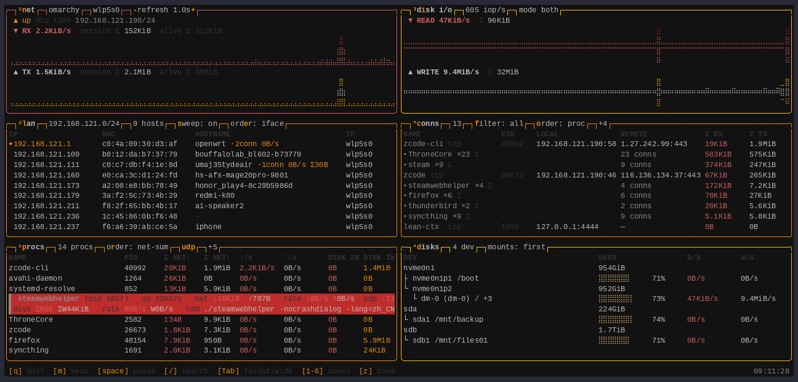

# TUI 界面

六个盒子各司一职。`Tab` 循环三种布局——**classic**（左图表右表格）、
**wide**（上图表下表格）、**tall**（单列）——`1`–`6` 开关盒子，关掉的盒子
干净收起。`z` 把焦点盒子放大全屏，`esc` 退出。`space` 冻结画面；暂停期间
发生的流量在恢复时补齐，不会漏账。

## 六个盒子

### 1 — NET

每网卡实时吞吐（盲文面积图，rx/tx 独立渐变色），加链路状态、速率、双工、
MTU 和地址。累计流量显示两份: ltop 启动以来（可重置）和接口启动以来。
`n` 切换图表模式；点表头切换网卡。

### 2 — LAN

自动发现的同子网设备（原理见 [LAN 发现](lan.md)）: IP、MAC、mDNS 主机名、
接口，网关有标记。每个邻居带实时连接数、当前速率和累计字节——数字与 CONNS
联动，"到那台机器的流量是多少"看一眼就知道，`enter` 置顶邻居并让 CONNS
只看这个对端。

### 3 / 4 — DISK I/O 与 DISKS

读/写速率图表（堆叠设备去重——`nvme0n1` 和它的 `dm-0(root)` 只算一份），
旁边是设备列表: 容量条加每设备实时速率，文件系统类型以暗色小字缀在设备名
后。**macOS** 上只列挂载卷: 虚拟机与模拟器会把虚拟盘以宿主可见的合成设备
形式挂出来——动辄十几个——而宿主看不到它们内部的容量与用量，这些行只是
噪声。**Linux** 上 VM 的磁盘不会成为宿主块设备（只是文件系统里的普通文
件），设备树如实反映硬件，保留完整物理树（盘 → 分区 → dm，含未挂载结构
行，LUKS/LVM 分层可读）。`d` 展开
挂载列表并把方向键/跳转键指向 disks 列表，`i` 切换图表模式。列表超长时
右缘出现 btop 式滚动条——点轨道翻页、拖滑块滚动，无需聚焦（滚轮本来就
不需要）。

### 5 — CONNS

系统全部 socket。TCP 连接显示真实逐连接 B/s 和总量；UDP 连接由 eBPF 计量
（Linux，经 [eBPF 助手](ebpf.md)），列与 TCP 相同。行带协议标签
（`tcp`/`udp`，本地对端标 `lan`），关闭的连接留 5 秒灰显**墓碑行**
（`tombstone_ttl_ms` 可配）——结束的传输在屏幕上还读得到。`f` 循环过滤
（all → lan → tcp → udp），`o` 循环排序——包括 **proc** 分组，同名进程折进
可展开的组头（`▸ firefox ×17`，组头带 Σ；组头上 `enter` 折叠/展开，搜索命中
自动展开）。

### 6 — PROCS

每进程**会话累计**: 网络（TCP+UDP——eBPF 在系统调用处计字节，短命连接不会
漏）和磁盘 I/O，加实时速率。退出的进程灰显保留，带捕获的命令行；`s`
一键重启，或 `enter` 开详情面板复制完整命令。`r` 循环排序（net-sum →
net-rate → disk-sum → disk-rate → name）。退出进程的账本默认 30 分钟后
清除（`proc_exit_retention_min`，`0` = 永久保留）。

## 焦点、选中与详情

- `p` / `c` / `l` 单焦点 PROCS / CONNS / LAN: 选中的盒子撑满注意力，其余
  变暗成占位。`esc` 清除。
- 方向键选中会**跟着行走**——重排、组折叠之后，你看的还是同一行。
- conns/procs 行上 `enter` 开**详情面板**: 进程显示状态、运行时长、完整
  捕获命令行、exe/cwd、RSS 和 UDP 分解；连接显示协议、属主、生命周期、
  总量与速率。面板内: `space`/`t` 追踪置顶（被追踪的行排最上），`k` 终止，
  `s` 重启，`↑↓` 移动字段光标，`y` 用 OSC 52 复制选中值（ssh 下直达本地
  剪贴板，不依赖 X11）。
- LAN 行上 `enter` **置顶**邻居（红色高亮，钉在最上）同时**让 CONNS 只看
  这个对端**；再按一次取消，`esc`/`f` 也能清。

## 搜索

`/` 按名字子串搜索进程与连接（`Tab` 换目标盒子，`enter` 应用，`esc` 清除）。
过滤后的视图仍按你选的模式排序。

## 终止的保护栏

`k` 终止选中的进程（或关闭 socket）。终止*其他用户*的进程需要在配置里开
`allow_global_kill = true`，默认拒绝。

## 监控日志

`L`（或启动时 `--log`）把每进程账本记到
`~/.local/state/ltop/ltop-log-<ts>.jsonl`，间隔 `log_interval_ms`（默认
60 秒），格式与 watch 同为 schema-v1 快照；保留期 `log_retention_days`
（默认 7 天），启动时清旧。回放与导出: `--replay [--csv OUT]`。详见
[数据面](data.md)。

## 完整键位表

| 按键 | 作用 |
|---|---|
| `q` / `Ctrl-C` | 退出 |
| `space` | 暂停/恢复采样（恢复时补齐） |
| `/` | 搜索（Tab 换盒子，enter 应用，esc 清除） |
| `m` | 菜单: 主题 / 设置 / 重置 / 图表 / 帮助 / 退出 |
| `Esc` | 清除焦点与选中；关闭面板 |
| `1`–`6` | 开关盒子: net、lan、disk i/o、disks、conns、procs |
| `Tab` | 布局 classic → wide → tall |
| `p` / `c` / `l` | 单焦点 procs / conns / lan |
| `r` | procs 排序循环 |
| `f` / `o` | conns 过滤循环 / 排序循环 |
| 组头上 `enter`、`←→` | 折叠 / 展开进程组 |
| `d` | 展开/收起磁盘挂载树；方向键/跳转键随即指向 disks 列表 |
| `e` | lan 排序: ip → hostname → mac → iface |
| `n` / `i` | net / disk 图表模式 |
| `↑↓` `PgUp` `PgDn` / 滚轮 | 移动选中；PgUp/PgDn 按可视高度翻页；滚轮滚动光标下的列表；点击选中 |
| disks 滚动条 | 点轨道翻页、拖滑块滚动——无需聚焦 |
| LAN 行上 `enter` | 置顶邻居 + CONNS 过滤到该对端 |
| conns/procs 行上 `enter` | 详情面板（追踪 `t`/`space`，终止 `k`，重启 `s`，复制 `y`） |
| `z` | 焦点盒子全屏缩放 |
| `Home`/`End`/`g`/`G` | 跳到首行/末行 |
| `L` | 监控日志开关 |
| `s` | LAN 扫描开关（主屏；详情面板里 `s` 是重启） |
| `+`/`-` | 刷新间隔 ±250 ms |

常用设置（都在 `m` → settings，持久化到 `~/.config/ltop/config.conf`）:
刷新 `tick_ms`（默认 2000）、墓碑 TTL、录制开关（与 `L` 键同路径）、日志
间隔/保留、扫描间隔、默认排序/过滤、`theme`、`lang`、
`proc_expand_default`（进程组默认展开）、`proc_exit_retention_min`、
`allow_global_kill`（暴露 `k` 键，默认关）、`allow_global_log`（暴露 `L` 录制
热键，默认关）。
